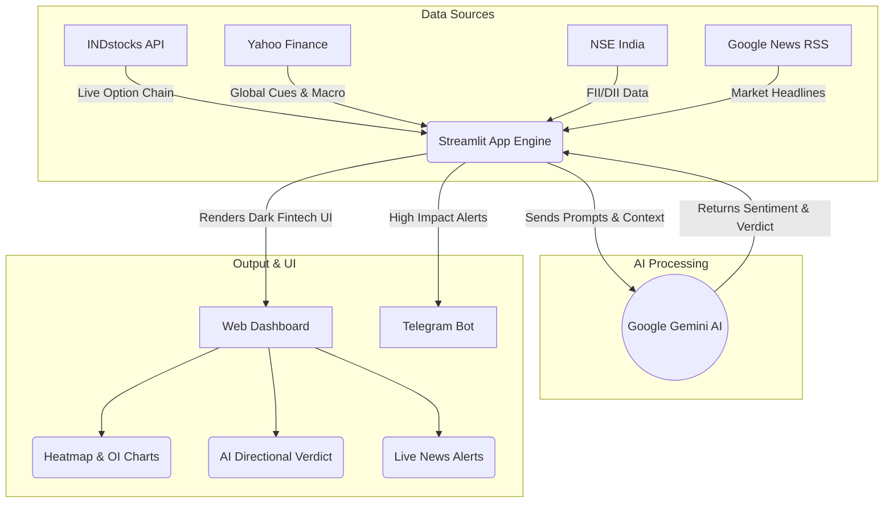

```markdown
# ⚡ AI Market Pulse: Nifty 50 & BankNifty Terminal


An advanced, dark-themed Fintech UI and AI-powered market terminal for Indian equity indices (Nifty 50 & Sensex). This dashboard aggregates real-time option chain data, global macro cues, FII/DII cash flows, and breaking news, utilizing Google Gemini AI to provide instant directional verdicts and scalping plans.

## 🚀 Key Features

- **Live Option Chain Analytics:** Real-time data from INDstocks API tracking ATM straddle spikes, Put-Call Ratio (PCR) drifts, and Max Pain strikes.
- **AI-Powered News Engine:** 30-second RSS polling from Google News with Gemini AI analyzing the impact (Bullish/Bearish/Neutral) of breaking headlines on the indices.
- **Institutional Flow Tracking:** Live updates on NSE FII/DII cash flows and FII index futures positioning.
- **Instant AI Verdict:** Combines options data, global cues (via yfinance), and news sentiment to generate a real-time trading bias (Upside/Downside/Sideways) and actionable scalper plans.
- **Telegram Integration:** Automated high-impact news alerts and AI verdicts sent directly to your Telegram chat/channel.

## 📰 Advanced News Engine & Freshness Policy

In market analysis, generating trading biases based on stale or improperly timestamped news can lead to disastrous false signals. To ensure the Gemini AI only evaluates truly recent market events, this project implements a rigorous **News Freshness Policy**:

- **Strict Timestamp Precedence:** Valid `published_parsed` values explicitly override `updated_parsed` to ensure the true original publication dates are used for AI evaluation.
- **Timezone-Aware UTC Validation:** All RSS feed timestamps are strictly converted to UTC. The system gracefully handles minor publisher clock skews (up to 5 minutes) while outright rejecting future-dated, stale, or missing timestamps.
- **Smart Deduplication:** Articles are deduplicated using normalized headline identities rather than relying on URLs or source suffixes. This ensures the top-10 headline cap remains clean and highly relevant.
- **Dynamic Snapshots:** Raw RSS data is never statically cached. Each polling cycle rebuilds a validated snapshot, and any snapshot older than 60 seconds is forcefully rebuilt before triggering a Gemini directional verdict call.

*Note on Source-Data Limitation:* If an RSS publisher rewrites the original publication time to its re-indexing time without exposing the original timestamp, the RSS metadata alone cannot resolve the true date without a separate publisher-page check.

## 🔄 System Architecture Flowchart



## 🛠️ Tech Stack

* **Frontend/Backend:** Python, Streamlit
* **AI & NLP:** Google Generative AI (Gemini 1.5 Flash / 2.5 Flash)
* **Market Data:** INDstocks API, `yfinance`, NSE FII/DII APIs
* **News Aggregation:** Google News RSS, `feedparser`
* **Notifications:** Telegram Bot API

## ⚙️ Installation & Setup

1. **Clone the repository:**
```bash
git clone [https://github.com/SidhuNegi/AI-DASHBOARD.git](https://github.com/SidhuNegi/AI-DASHBOARD.git)
cd AI-DASHBOARD

```


2. **Install dependencies:**
```bash
pip install -r requirements.txt

```


3. **Configure Secrets:**
Create a `.streamlit/secrets.toml` file in the root directory and add your API keys:
```toml
GEMINI_API_KEY = "your-gemini-key"
INDSTOCKS_ACCESS_TOKEN = "your-indstocks-access-token"
TELEGRAM_BOT_TOKEN = "your-telegram-bot-token" # Optional
TELEGRAM_CHAT_ID = "your-telegram-chat-id"     # Optional

```


4. **Run the application:**
```bash
streamlit run app.py

```


## 🧪 Testing & Reliability

To guarantee the reliability of this news engine against various edge cases (such as missing timestamps, timezone discrepancies, and invalid RSS structures), the core services are backed by a deterministic offline testing suite.

Run the test suite using synthetic RSS-like entries and injected UTC clocks:

```bash
python -m unittest discover -s tests -v

```

*(The project currently passes 31 comprehensive tests covering timestamp parsing, freshness validation, and snapshot integrity.)*

## 📊 Usage

* Select your primary index (**NIFTY** or **BANKNIFTY**) from the sidebar.
* Adjust the auto-refresh rate (5s, 15s, 30s, 60s) based on your trading style.
* Monitor the **Heatmap Matrix** for top Support (PE OI) and Resistance (CE OI) zones.
* Keep an eye on the **Alert Banner** at the top for high-impact breaking news.

## 📝 License

This project is licensed under the MIT License.

```

```
